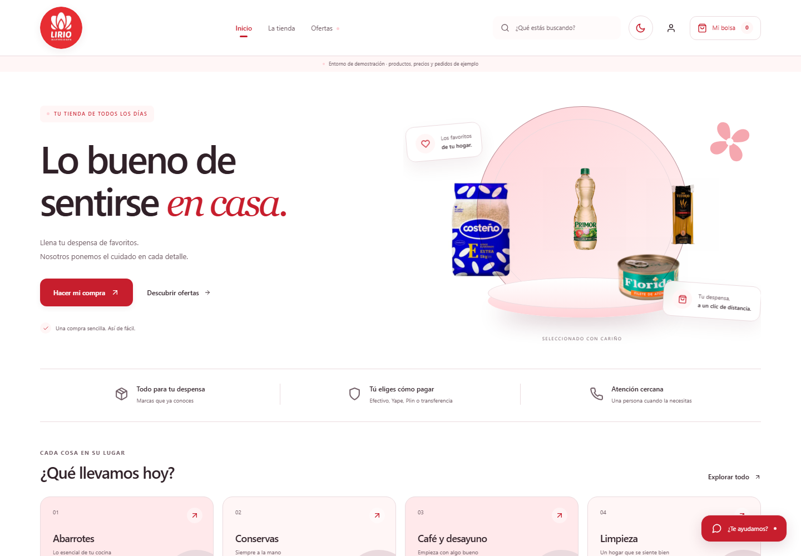
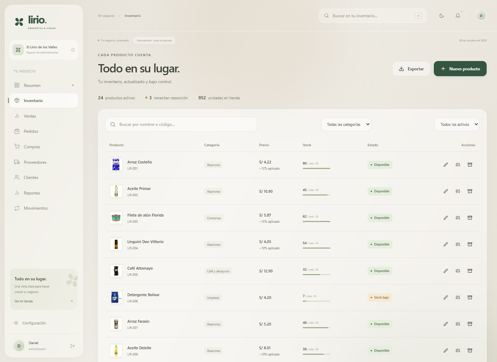
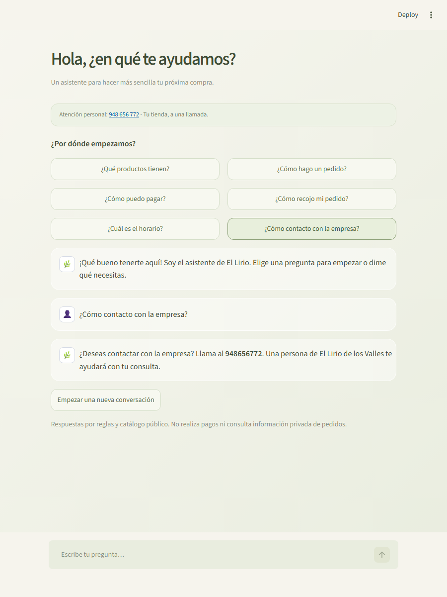
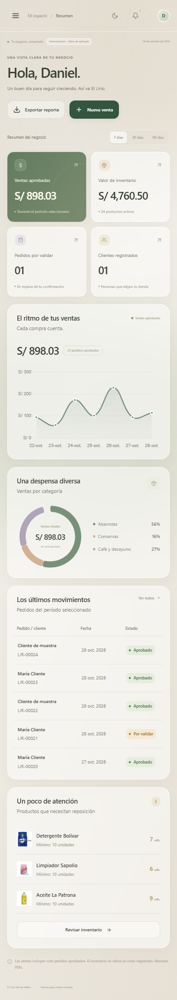
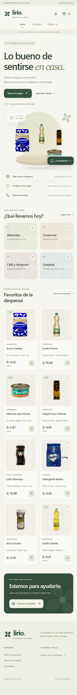
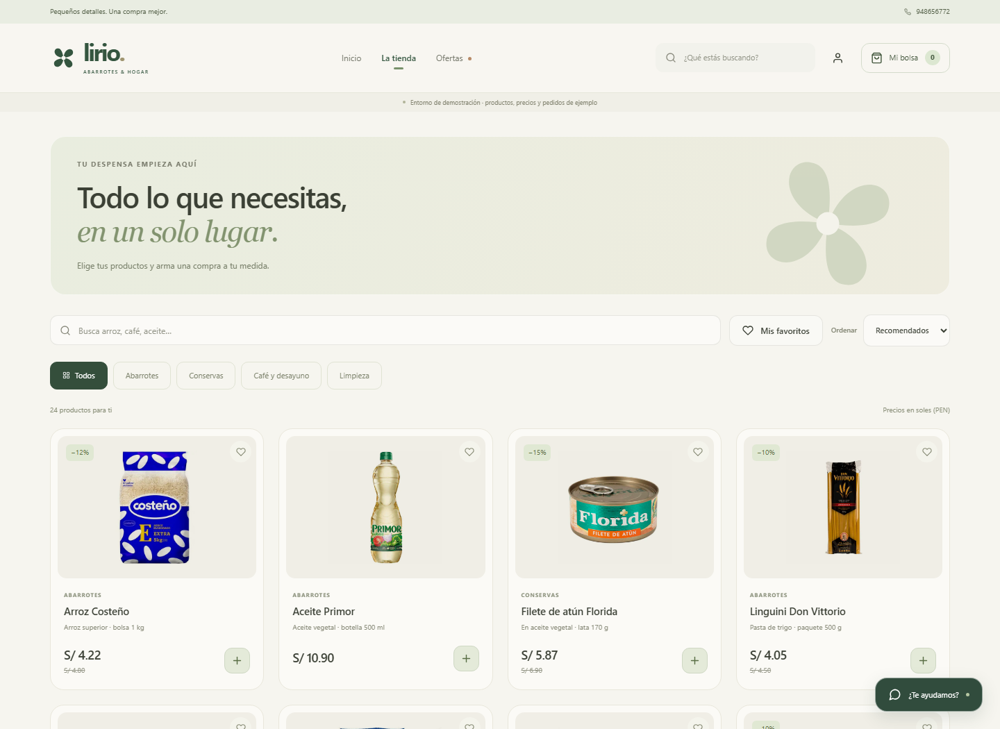

<h1 align="center">El Lirio · Abarrotes & hogar</h1>

Una compra sencilla. Un inventario en orden.

<b>React 19 · Vite 7 · Java 21 · Spring Boot · MySQL · Streamlit</b>

Sistema de ventas e inventario para **El Lirio de los Valles**, con tienda para clientes y administración conectada al servidor. Diseño inspirado en iOS: vidrio translúcido, tonos cálidos, verde salvia, transiciones suaves y distribución adaptable a celular. Las animaciones respetan la preferencia de movimiento reducido.

**Rama de entrega: version-final-lirio**, basada en inventario-backendv2. Las cuatro ramas se revisaron y se conservaron. [Revisión de ramas](docs/REVISION_RAMAS.md).

## La experiencia

| Para tus clientes | Para tu negocio |
|---|---|
| Búsqueda, categorías, favoritos y ofertas | Panel con ventas, inventario y alertas reales |
| Detalle de producto y bolsa con cantidades | Productos, categorías, marcas y ajustes con motivo |
| Registro, sesión y perfil | Ventas en mostrador y validación de pagos |
| Efectivo, Yape, Plin o transferencia | Proveedores y compras con recepción de mercadería |
| Comprobante y seguimiento de pedidos | Clientes, movimientos y exportación CSV |
| Asistente Streamlit con preguntas sugeridas | Configuración persistente y tema claro u oscuro |

### Tu negocio, de un vistazo

### Cada producto en su lugar

### Un asistente cercano

El chatbot está hecho con **Streamlit**, consulta el catálogo público y orienta sobre productos, pedidos, pagos, recojo, horarios y contacto. No necesita clave de IA.

La alternativa **«¿Cómo contacto con la empresa?»** responde:

> ¿Deseas contactar con la empresa? Llama al **948656772**. Una persona de El Lirio de los Valles te ayudará con tu consulta.

Vista móvil y catálogo

 

## Cómo ejecutarlo

Requisitos: **Java 21**, **Node.js 20.19+ o 22+**, **Python 3.11+** e internet para la primera instalación. Incluye Maven Wrapper.

    cd Gestion_inventario_Lirio
    python iniciar.py --instalar

Después de la primera instalación:

    python iniciar.py

Abre **http://127.0.0.1:5173**. El script inicia backend, web y chatbot, guarda registros en **.data/** y los detiene con **Ctrl+C**.

En Windows, después de instalar:

- **INICIAR_PROYECTO.bat**: inicia los tres servicios. **INICIAR_LIRIO.cmd** sigue funcionando como acceso compatible.
- **DETENER_PROYECTO.bat**: solicita el cierre de esa ejecución, espera que terminen sus servicios y confirma el resultado. Puedes pulsarlo mientras el proyecto está iniciando o cuando ya está listo. No cierra aplicaciones por nombre ni por puerto.

También puedes detenerlo desde una terminal con **python detener.py**. Detenerlo otra vez es seguro. Mantén abierta la ventana del iniciador hasta detener el proyecto; el cierre se coordina con ella.

| Cuenta de demostración | Correo | Contraseña |
|---|---|---|
| Administración | admin@lirio.local | LirioDemo2026! |
| Cliente | cliente@lirio.local | ClienteDemo2026! |

La demostración usa **H2 local persistente**, independiente de MySQL, con 24 productos y pedidos de muestra. La interfaz identifica este entorno. Precios y operaciones de ejemplo no representan datos reales del negocio. Se conservan entre reinicios en **.data/lirio.mv.db**.

## Instalar con MySQL

Incluye **Docker Compose**, backend Java, Nginx y chatbot bajo el mismo origen. Copia **.env.example** a **.env**, completa los secretos y ejecuta:

    docker compose up --build -d

Abre **http://localhost:8088**. Este modo no carga operaciones de ejemplo. Consulta [instalación, respaldo, variables y límites de validación](docs/DESPLIEGUE.md) antes de usar datos reales.

## Reglas que cuidan tu inventario

- El servidor calcula precios y descuentos con precisión decimal y verifica el total esperado.
- Los pedidos reservan stock en una transacción; sus reintentos no duplican efectos.
- Solo ADMIN valida pagos. Rechazar devuelve la reserva una sola vez.
- Una compra pendiente no aumenta stock. Recibirla sí; repetir la recepción no duplica unidades.
- Los ajustes requieren motivo. Archivar conserva el historial.
- Los comprobantes son privados y se validan como imágenes.
- Los reportes distinguen ventas aprobadas, valor de inventario y margen bruto.

[Arquitectura y reglas completas](docs/ARQUITECTURA.md).

## Verificación

    # Backend (en Windows: mvnw.cmd test)
    ./mvnw test

    # Chatbot
    python -m unittest discover -s chatbot/tests -v

    # Interfaz y navegador
    cd el-lirio-frontend
    npm ci
    npm run build
    npm audit
    npx playwright install chromium
    cd ..
    python verificar_web.py

La última orden inicia servicios temporales, captura pantallas, prueba escritorio y móvil y los detiene. Las pruebas Java usan una base en memoria aislada. Las pruebas de navegador crean registros en la demostración local.

**Resultados:** 19 pruebas Java, 12 de navegador, 8 de chatbot y 5 de coordinación de inicio/cierre aprobadas; compilación correcta y 0 vulnerabilidades npm. También se comprobó el ciclo real de los accesos de Windows. Las capturas provienen de la aplicación funcionando. [Resultados y alcance](docs/VALIDACION.md).

## Estructura

    Gestion_inventario_Lirio/
    ├── el-lirio-frontend/   # React, estilos, navegador y Nginx
    ├── src/                # API Java, entidades JPA y pruebas
    ├── chatbot/            # Streamlit, respuestas y pruebas
    ├── uploads/productos/  # Fotografías originales
    ├── docs/               # Capturas, arquitectura y despliegue
    ├── legacy/             # Avance anterior fuera de la aplicación activa
    ├── compose.yaml        # MySQL + API + web + chatbot
    ├── iniciar.py          # Inicio local
    └── verificar_web.py    # Verificación con servicios temporales

## Datos del negocio

La dirección, horarios y datos de pago deben confirmarse con el negocio; no se publica un QR ni una cuenta bancaria sin verificar. Los pagos digitales se revisan manualmente y el efectivo se confirma al recoger.

Los documentos son registros operativos. La aplicación no realiza cargos, transferencias, facturación electrónica ni devoluciones bancarias.

**Antes de publicar:** cambia las credenciales expuestas en el historial del avance original y revisa las notas de soporte y validación de MySQL en [Despliegue](docs/DESPLIEGUE.md).
