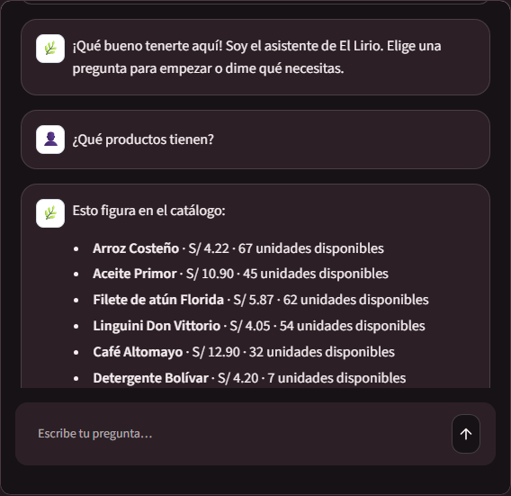
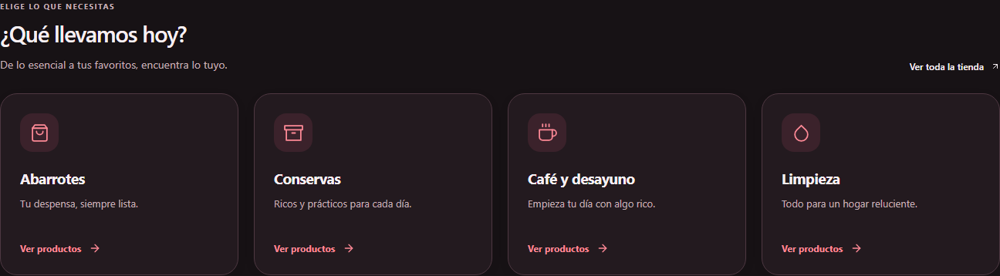
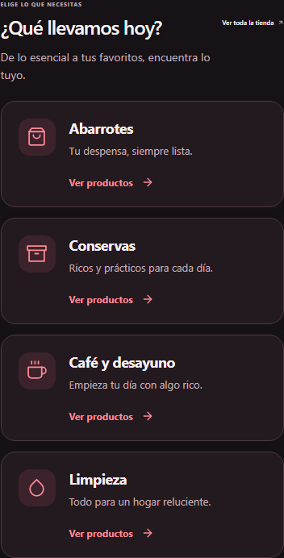

# Identidad visual de Lirio Inversiones

Se incorpora el logo JPG original proporcionado por el negocio en cabecera, pie, acceso, administración e icono del navegador. El archivo se conserva sin modificar. Los colores se definen en **src/lirio/styles/theme.css**: superficies blancas y acentos rojos en modo claro; superficies oscuras y acentos rojos con contraste en modo oscuro. Los estados de éxito, advertencia y rechazo conservan su significado.

El botón accesible de luna o sol está disponible en tienda, acceso y administración. El tema inicial respeta la preferencia del dispositivo y la selección se guarda en **lirio.theme**. Cambiar de modo no borra los campos del acceso, la bolsa ni los favoritos. El tema se aplica antes del renderizado para evitar destellos claros al recargar.

La franja «Pequeños detalles. Una compra mejor.» se elimina completa, incluido su teléfono. El asistente conserva su función de contacto. Su iframe recibe un modo validado por el propio chatbot para aplicar los mismos fondos y colores.

## Verificación

Las seis pruebas de **e2e/branding.spec.js** cubren escritorio y móvil: logo, ausencia de franja y enlace telefónico en la cabecera, cambio con teclado, persistencia al navegar y recargar, preferencia del sistema, conservación de campos, bolsa y fondo oscuro efectivo del chatbot. Pasaron el análisis estático y la compilación. Se revisaron visualmente tienda, acceso y administración en ambos modos, y se comprobó la respuesta de contacto del asistente.

La actualización desplegada reconstruye solo web y chatbot. El backend, las credenciales y los volúmenes de MySQL y comprobantes se conservan. La dirección pública sigue siendo la misma.

## Uso

1. Abre la tienda y pulsa la luna para activar el modo oscuro o el sol para volver al modo claro.
2. En el equipo servidor, usa **COMPARTIR_PROYECTO.bat** con Docker abierto para publicar, y **DETENER_PROYECTO.bat** para cerrar.

## Revisión del contraste en modo oscuro

Se corrige la herencia del tema claro en las listas Markdown del asistente. Listas, texto resaltado, enlaces, tablas y bloques de código siguen la paleta activa. Las notas pequeñas usan un color legible y opacidad completa. Las miniaturas de detalle, bolsa, pedidos, checkout y punto de venta conservan un fondo claro para evitar que la mezcla de colores las oscurezca.

Se revisaron 31 vistas y estados con una auditoría de contraste: tienda, catálogo, ofertas, detalle, acceso, registro, recuperación, cuenta, pedidos, checkout, administración, tablas, formularios nuevos, notificaciones y móvil. La comprobación final no detectó infracciones automáticas de contraste. Los fondos con gradientes y los gráficos que requieren inspección visual también se revisaron; la auditoría no constituye una certificación completa de accesibilidad.

Las cuatro pruebas de **e2e/dark-contrast.spec.js** miden el contraste real de las listas de productos y las notas del asistente en claro y oscuro, incluyendo la opacidad de sus contenedores. También comprueban textos de catálogo, bolsa y formularios en escritorio y móvil, con un mínimo de 4,5:1 para el texto probado.

## Categorías fáciles de explorar

Las categorías de inicio usan iconos, títulos de mayor tamaño, descripciones completas y una acción **Ver productos**. Se retiraron los números y círculos decorativos que podían tapar el texto. El contenido crece con sus líneas, sin alturas rígidas ni recortes.

La distribución tiene cuatro columnas en escritorio, dos en pantallas intermedias y filas horizontales en móvil. Se comprobaron 320, 390, 768, 1024 y 1440 píxeles en ambos modos, incluyendo contraste, ausencia de solapamientos y navegación a los cuatro catálogos filtrados. El acceso al asistente conserva su etiqueta accesible y usa un botón compacto en móvil.

