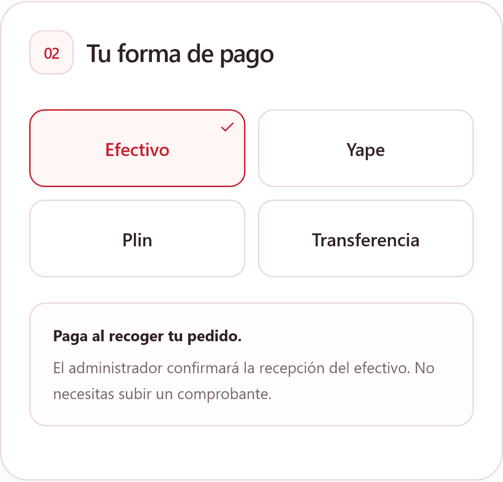
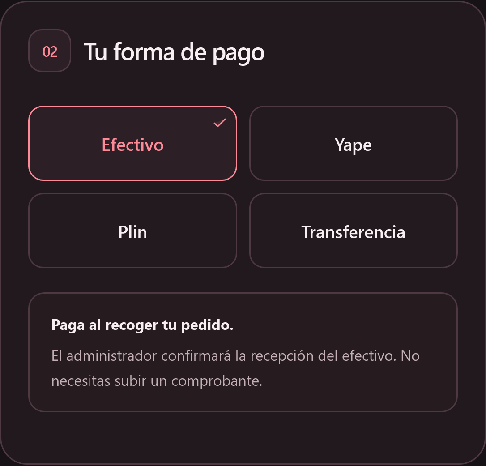

# Validación de la experiencia móvil

Revisión del 29 de octubre de 2026. La tienda conserva su diseño rojo y blanco y sus modos claro y oscuro.

## Fallo corregido

En WebKit, el ancho natural del selector de archivos se transmitía a las columnas del pago. En el perfil del iPhone 17, una pantalla de 402 px terminaba con un contenido de 417 px al elegir un pago digital. Un comprobante de nombre largo podía ampliar el contenido hasta 1275 px.

La corrección limita los controles al ancho disponible, permite partir nombres largos y elimina el mínimo implícito de las columnas. Los métodos de pago mantienen su posición al cambiar la selección. En móvil y tablet, el resumen se coloca debajo del formulario.

También se ajustaron los formularios de productos y compras, la cabecera de administración en pantallas estrechas y los campos de entrada. Los campos y el cuadro del asistente usan al menos 16 px para evitar la ampliación automática de Safari al escribir. El zoom manual permanece disponible.

El botón flotante del asistente se oculta durante el pago en pantallas de hasta 1024 px para dejar libre el formulario. El asistente sigue accesible desde el pie de página y se mantiene la ayuda de contacto del resumen.

## Comprobaciones

| Área | Alcance |
| --- | --- |
| Motores | Chromium y WebKit 27.2 con Playwright en Windows |
| Pago | 320, 360, 375, 390, 402, 430, 440, 480, 600, 768 y 1024 px; además, perfiles horizontales de iPhone 17 y 17 Pro Max |
| Estados del pago | Efectivo, Yape, Plin, transferencia y comprobante con nombre largo; ambos temas: 260 estados sin desbordamiento |
| Navegación | Inicio, catálogo, ofertas, detalle, acceso, registro, recuperación, cuenta, pedidos y vistas de administración |
| Ventanas y menús | Bolsa, asistente con respuesta de productos, menús de cuenta y administración, notificaciones y formularios de productos, compras y proveedores |
| Revisión general | 348 estados en 320, 402 y 756 px, en ambos motores y temas, sin desbordamientos ni campos de entrada inferiores a 16 px |
| Perfil público | iPhone 17 de Playwright: área visible de 402 × 681 px, en claro y oscuro, sobre la dirección pública de la tienda |
| Regresión permanente | 36 casos con datos simulados: dos configuraciones de Chromium y una de WebKit; seis anchos y ambos temas |

Las pruebas de pago recorren las opciones, adjuntan una imagen de prueba, verifican los anchos y comprueban la selección con teclado. No confirman pedidos. La revisión del catálogo y la administración utiliza consultas y abre formularios sin guardarlos.

Las comprobaciones se realizaron con emulación de pantallas y el motor WebKit, no con un iPhone físico. Las dimensiones disponibles con las barras de Safari cambian al desplazarse; una comprobación final desde el dispositivo permite confirmar también su teclado y preferencias particulares.

## Capturas de la versión publicada




## Cómo ejecutar las pruebas

Dentro de `el-lirio-frontend`:

1. Instalar las dependencias: `npm ci`.
2. Instalar los navegadores de prueba: `npx playwright install chromium webkit`. En Linux puede ser necesario `--with-deps`.
3. Compilar la aplicación: `npm run build`.
4. En PowerShell, ejecutar:

   ```powershell
   $env:PLAYWRIGHT_START_SERVER = "1"
   $env:PLAYWRIGHT_BASE_URL = "http://127.0.0.1:4173"
   npx playwright test mobile-layout.spec.js
   ```

Playwright inicia y detiene el servidor de vista previa. Las respuestas de la API están simuladas en estas pruebas: no requieren credenciales ni un backend. GitHub Actions ejecuta esta misma regresión en cada actualización del repositorio.

Perfiles y emulación: [documentación de Playwright](https://playwright.dev/docs/emulation). Configuración del servidor de pruebas: [Playwright webServer](https://playwright.dev/docs/test-webserver).
